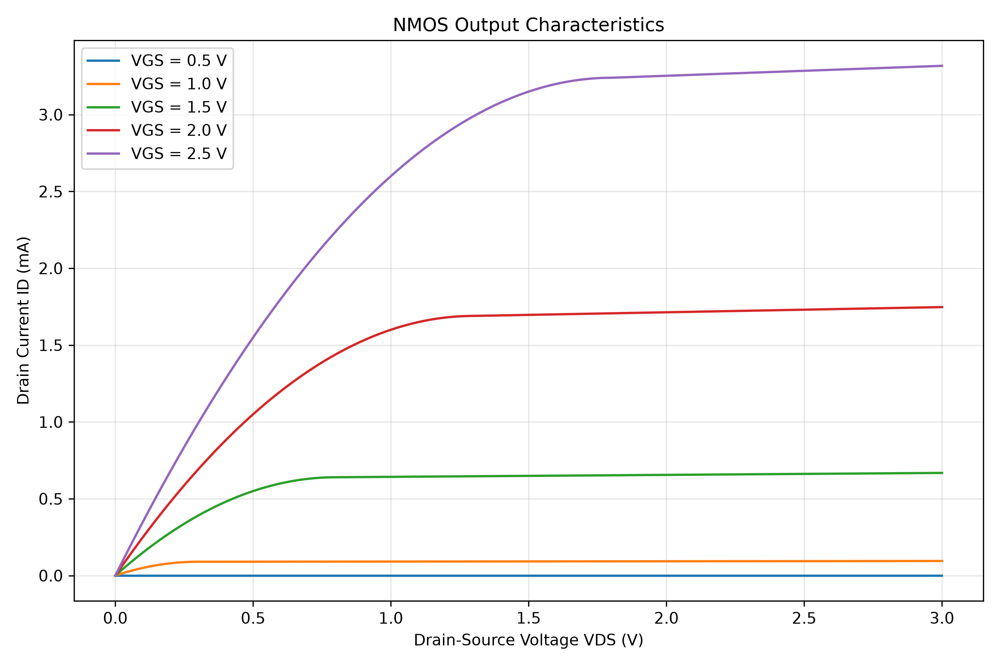
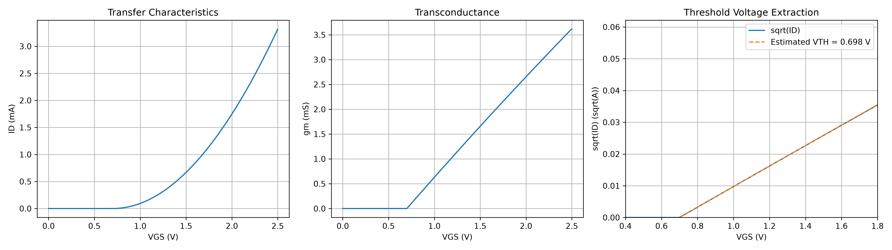

# MOSFET Device Physics Simulator

An interactive Python-based simulator for analyzing the electrical characteristics of a long-channel NMOS transistor.

The project demonstrates semiconductor device physics, numerical computation, transistor characterization, and automated software testing.

## Features

- NMOS drain current modeling in cutoff, triode, and saturation regions
- Output characteristics: drain current versus drain-source voltage
- Transfer characteristics: drain current versus gate-source voltage
- Numerical transconductance analysis
- Threshold-voltage estimation using square-root current fitting
- Interactive Streamlit dashboard with adjustable device parameters
- CSV export of simulation results
- Automated verification using pytest

## Simulation Results

### 1. Output Characteristics



The output curves illustrate how drain current changes with drain-source voltage for different gate-source voltages.

### 2. Transfer Characteristics and Threshold Extraction



The analysis includes transfer characteristics, transconductance, and threshold-voltage estimation.

## Physics Model

The simulator implements the classical long-channel MOSFET square-law model.

For cutoff:

ID = 0 when VGS <= VTH.

For the triode region:

ID = μCox(W/L)[(VGS - VTH)VDS - VDS²/2]

For saturation:

ID = (1/2)μCox(W/L)(VGS - VTH)²
     × [1 + λ(VDS - (VGS - VTH))]

where:

- VGS: Gate-source voltage
- VDS: Drain-source voltage
- VTH: Threshold voltage
- μCox: Mobility-oxide-capacitance product
- W/L: Transistor width-to-length ratio
- λ: Channel-length modulation parameter

The model is intended for educational characterization rather than calibrated industrial transistor simulation. Subthreshold conduction, body effect, and short-channel effects are not included.

## Technology Stack

- Python
- NumPy and SciPy
- Matplotlib and Plotly
- Pandas
- Streamlit
- pytest

## Installation

Clone the repository:

```bash
git clone https://github.com/hiten809/semiconductor-mosfet-simulator.git
cd semiconductor-mosfet-simulator/01-mosfet-simulator
```

Create a virtual environment:

```bash
python3 -m venv .venv
source .venv/bin/activate
python -m pip install -r requirements.txt
```

## Run the Interactive Dashboard

```bash
python -m streamlit run app.py \
  --server.headless true \
  --server.fileWatcherType none
```

Open the local URL displayed in your terminal.

## Generate Simulation Plots

```bash
python -m src.mosfet
python -m src.transfer_analysis
```

Generated figures are saved in the `results/` directory.

## Run Automated Tests

```bash
python -m pytest tests/ -v
```

**Verification:** 13 automated tests passed during development.

## Project Structure

```text
01-mosfet-simulator/
├── app.py
├── src/
│   ├── device_model.py
│   ├── mosfet.py
│   └── transfer_analysis.py
├── tests/
│   ├── test_device_model.py
│   └── test_mosfet.py
├── results/
│   ├── mosfet_output.png
│   ├── transfer_analysis.png
│   └── test_report.txt
├── requirements.txt
└── README.md
```

## Limitations and Future Work

- PMOS device modeling
- Temperature-dependent mobility
- Subthreshold conduction
- SPICE-based model comparison
- Experimental current-voltage data fitting
- Improved threshold extraction methods

## Author

Hiten Kaistha  
B.Tech — Engineering Physics / Physics & Photonic Sciences  
National Institute of Technology Hamirpur
